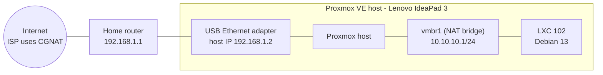
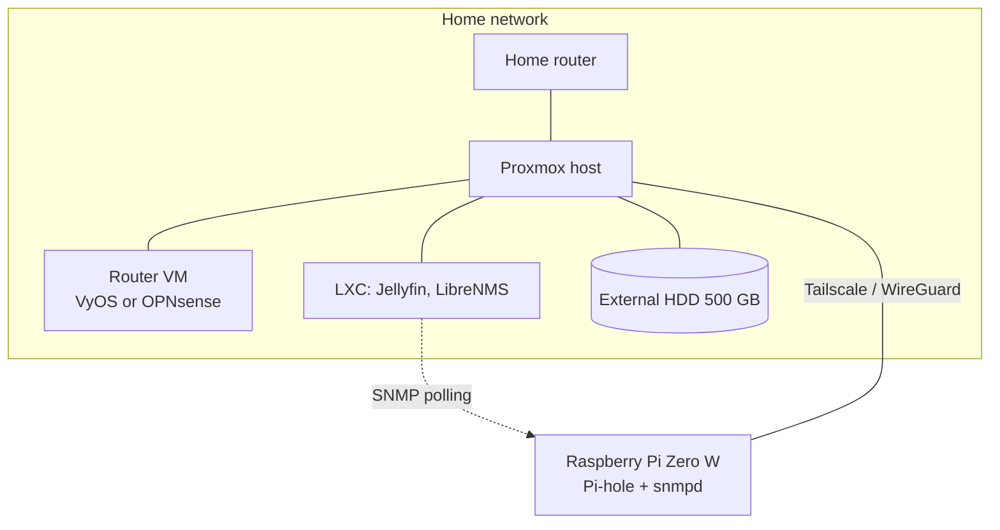

# Proxmox Network Homelab

A hands-on networking lab built on a single laptop running Proxmox VE, a Raspberry Pi Zero W as a future remote node, and a 500 GB external hard drive. I use it to practice the skills behind the CCNA: bridging and switching concepts, NAT, routing, DNS, VPNs, monitoring and troubleshooting.

**Status:** active, work in progress. Everything under *Completed* is running or documented. Everything under *Planned* is **not built yet**.

**Author:** Joseph Marcell Lugo Brown, third-year IT Management student (ATI) at TEC, Costa Rica. Preparing for the CCNA. [GitHub profile](https://github.com/marcell6449)

---

## Goals

- Build and break a real network on limited hardware, and document every problem with its root cause and fix.
- Provide NAT, DNS, VPN access, monitoring and video streaming (Jellyfin) from one host.
- Reach a multi-site design (simulated sites) connected with WireGuard.

## Hardware

| Role | Device | Details |
| --- | --- | --- |
| Hypervisor host | Lenovo IdeaPad 3 (81WA) | Intel Core i3, 8 GB DDR4, runs Proxmox VE. *(complete: exact CPU model, internal disk size/type, Proxmox version)* |
| Uplink | USB-A to RJ45 Ethernet adapter | *(complete: chipset from `lsusb`)* |
| Media storage | External USB hard drive | 500 GB, planned for Jellyfin media |
| Remote node | Raspberry Pi Zero W | 512 MB RAM, 1 GHz single core, 2.4 GHz Wi-Fi only. Planned for Pi-hole and SNMP agent |

## Current architecture

This is the active configuration (see [INC-001](docs/troubleshooting.md#inc-001)). IP addresses are examples.



A proposed change, where the USB adapter becomes a bridge port so containers share the LAN, is described in [INC-002](docs/troubleshooting.md#inc-002) and is **pending verification**.

## Planned architecture



## Completed

- Proxmox VE installed on the IdeaPad 3. Details in [docs/proxmox.md](docs/proxmox.md).
- Identified that my ISP uses **CGNAT** with `mtr`, so inbound connections are not possible. Remote access is solved with **Tailscale**.
- Diagnosed and worked around a USB Ethernet adapter that failed as a port of `vmbr0` ([INC-001](docs/troubleshooting.md#inc-001)): host IP on the USB interface plus an isolated NAT bridge `vmbr1`.
- Created an unprivileged **LXC container** (ID 102, Debian 13). See [docs/containers.md](docs/containers.md).
- Configured static routes, enabled container nesting, enabled TUN/TAP for a future OpenVPN test, and set Cloudflare as upstream DNS. See [docs/networking-notes.md](docs/networking-notes.md).
- Wake-on-LAN service configured (wake-up test pending).

## Incident log

| ID | Date | Summary | Status |
| --- | --- | --- | --- |
| [INC-001](docs/troubleshooting.md#inc-001) | 2026-09-17 | Proxmox unreachable: USB Ethernet adapter did not work as a port of `vmbr0`. Fixed with host IP on the adapter and NAT bridge `vmbr1`. | Resolved |
| [INC-002](docs/troubleshooting.md#inc-002) | 2026-10-01 | Containers had no LAN access because `vmbr1` had no uplink. Fix: move host IP to `vmbr1` with the USB adapter as bridge port. | Pending apply and verification |

## Lessons learned

- An interface that is a bridge port cannot hold its own IP. The IP belongs on the bridge.
- Not every USB Ethernet adapter is reliable as a bridge port. An isolated NAT bridge is a safe fallback, and every change needs a rollback plan.
- Behind CGNAT there is no public IPv4 address for inbound traffic, so an overlay VPN such as Tailscale (built on WireGuard) is the practical solution.
- Good incident notes include symptom, OSI layer, evidence, root cause, fix and rollback.

## Skills demonstrated

- **Linux networking:** bridges, static addressing, NAT masquerading, IP forwarding, static routes (`ip`, `bridge`, `ethtool`, `iptables`, `mtr`).
- **Virtualization:** Proxmox VE, unprivileged LXC containers, nesting and TUN/TAP options.
- **Troubleshooting:** layered diagnosis (OSI), recovery access, documented rollback.
- **DNS and remote access:** upstream DNS configuration, secure access under CGNAT.
- **Technical documentation:** incident reports and configuration notes.

## Roadmap

- [x] Proxmox VE installed
- [x] CGNAT identified, Tailscale for remote access
- [x] INC-001 resolved (NAT bridge)
- [x] First LXC container (Debian 13)
- [ ] INC-002 applied and verified
- [ ] Jellyfin in an LXC container using the external HDD
- [ ] Raspberry Pi Zero W: Pi-hole and `snmpd`
- [ ] LibreNMS monitoring with alerts
- [ ] Router VM (VyOS or OPNsense) per simulated site
- [ ] WireGuard tunnel between sites
- [ ] VLAN segmentation, IDS, IPS and configuration backups

## Repository structure

```
.
├── README.md
├── LICENSE
└── docs/
    ├──VLAN/
        ├──IDS-IPS
        └──configuration backups  
    ├── Proxmox.md
    ├── container.md
    ├── wiregard.md
    ├── Jellyfin
    ├── LibreNMS
    ├── Router VM
    └── NETWORK_TROUBLESHOOTING.md
```

## License

MIT. See `LICENSE`.
